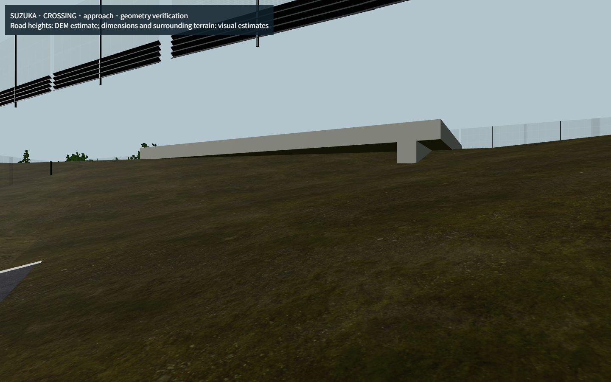
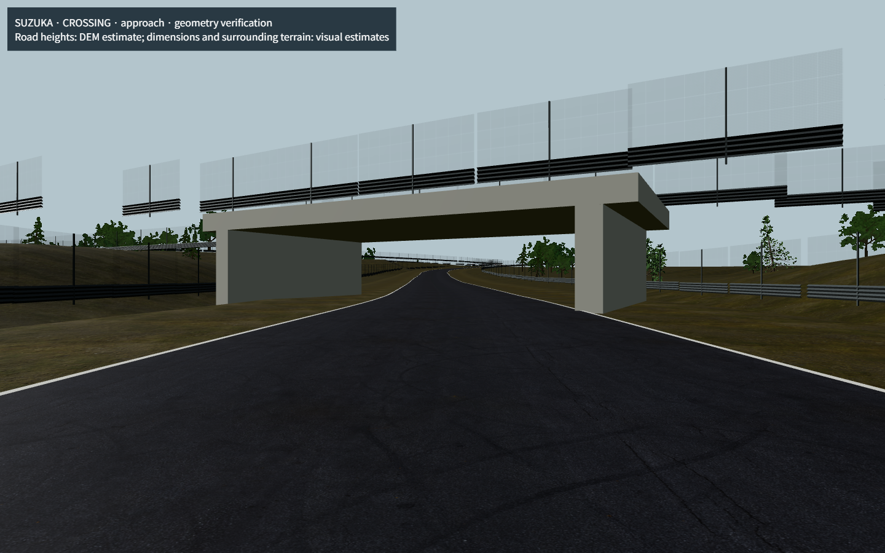
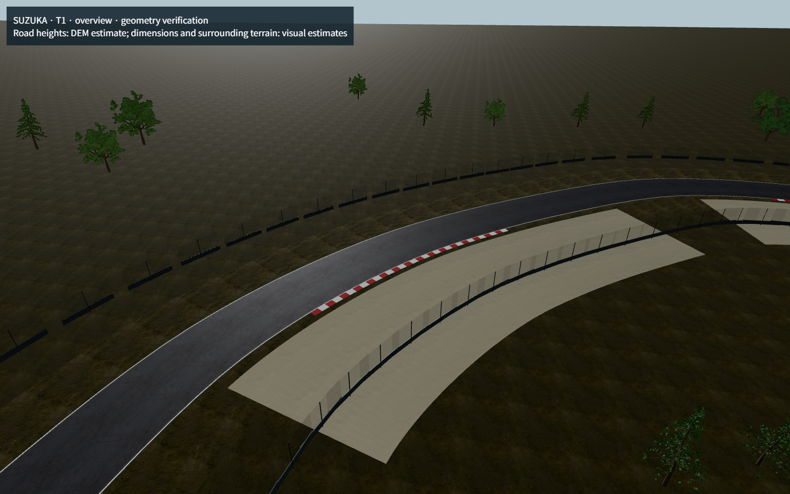
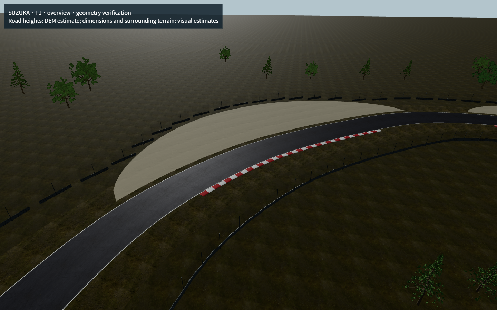

# 鈴鹿専用の描画改修・監査と検証

## 比較の基準

公開版 `a5ead34` の保存済みソースを、ユーザーの承認に基づき `codex/published-a5ead34-baseline`（`4d8267d`）へ保存した。今回の改修ブランチは `codex/suzuka-visual-refinement`。PRの比較先はこの公開版基準ブランチであり、masterの変更やマージ、本番公開は行わない。

元の作業ディレクトリには公開版を構成した未コミット変更が多数あったため、その変更を選別・リセットせず、独立したレビュー用チェックアウトに基準ソースを展開した。基準ソースの保存と鈴鹿改修のコミットを分離する。

## 作業前の依存関係監査

| 対象 | 確認内容・今回の扱い |
|---|---|
| AGENTS / CLAUDE / HANDOFF | 公開ゲート、過去の物理変更、公開済み未コミットソースを確認。最新のユーザー指示を優先し、公開処理は配信前に停止した。 |
| RaceScene.tsx | Overview Mapと受信位置補間を担当。今回の変更なし。 |
| trackGeometry.ts | Map用の正規化された中心線・路面生成。今回の変更なし。 |
| tracks.ts | OpenF1中心線、コーナー、セクター、マーシャルポスト、ピット、公式周長等を統合。今回の変更なし。 |
| realTrackLayouts.ts | 自動生成された中心線・投影情報。直接編集していない。 |
| measuredRoadProfiles.ts | 出典と信頼度付きの公開標高・道路推定データ。標高、勾配、幅、バンク情報を変更していない。 |
| RaceView.tsx | Suzuka / F1 / SIM / 1xの既存条件でCinematicを遅延ロード。条件、UI、操作方法を維持。 |
| CinematicScene / Cameras / FormulaCar | 既存の車両・カメラ・照明・補間を維持。今回の変更なし。 |
| SuzukaTrack / suzukaSurface / TrackBarriers | 既存の鈴鹿専用描画内で今回の変更を実装。 |
| SuzukaScenery | ピットビル・主スタンド・管制塔・観覧車・樹木が既にあるため重複実装しない。未測量の施設位置を新たに正確だと主張しない。 |

鈴鹿のCinematic座標は、既存中心線の弧長を宣言周長5807mへ換算し、既存の標高プロファイルに接続している。今回、この換算、roadPose、elevationAt、widthAt、pitOffsetの計算は変更していない。エンジンは描画メッシュを参照しないため、追加の縁石・ランオフ・地形はグリップや衝突、車両進行へ影響しない。

## 実装

### 立体交差と地形

地形の「最寄り道路の高さ」を使う補完が、上側道路の高さで下側道路を塞いでいた。交差付近の頂点間隔を3mまで細分化し、複数道路の距離による高さ補間を滑らかにしたうえで、下側路面に沿う開口を確保した。遠景の基本分割は維持した。橋上の芝肩とバリアは既存の推定14m幅の橋桁内へ寄せ、前後へ滑らかに接続する。

### 縁石・路面・ランオフ

従来はすべてのコーナーで同じ長さ・幅・32分割の平面縁石を描画していた。`suzukaVisualData.ts` に既存18コーナーの識別と個別の視覚定義を分離し、S字、デグナー、ヘアピン、スプーン、130R、シケイン等で長さ・幅・高さ・ストライプ幅を変えた。断面を持つ赤白の縁石を2つの共有メッシュに結合し、第2コーナー・スプーン出口・最終コーナーには出口側も定義した。未確認の弱い屈曲部へ一律の縁石を置かない。

グラベルと舗装ランオフを、コーナー外側の曲率と局所的な幅に沿って生成する。外側バリアはランオフの外へ逃がし、グラベルを横切らないようにする。アスファルトは既存PBR素材を再利用して暗灰色へ調整し、既存のピット表示経路に境界白線を加えた。経路そのものと車両のピット処理は変更しない。

### 資料と精度

[鈴鹿公式コースガイド](https://www.suzukacircuit.jp/course_s/pdf/suzuka_courseguide.pdf)と[公式の観戦エリアガイド](https://www.suzukacircuit.jp/eng/course_s/)を、コーナー識別と周辺配置の参照に使用した。画像・写真・地図のテクスチャへの転用や抽出は行っていない。閲覧日は2026-10-17。

既存OpenF1のコーナー位置は維持する。今回定義した縁石の延長・幅・断面、ランオフの輪郭と幅、バリアの局所オフセット、地形の盛土形状は**視覚的推定**であり、測量値ではない。資料から寸法を確定できない施設・タイヤバリア・マーシャルポストは追加せず、コース全周へ汎用品を新しく並べる実装を避けた。現地の全設備を正確に再現したものではない。

## 機能維持と性能

`src/simulation / src/workers / src/data / src/services / src/components / src/restored20261010`、App、RaceScene、RaceView、カメラ、package.json、lockfileに、公開版基準との変更はない。元のタイヤ・燃料・ERS・AI・天候・タイミング・セーブ仕様も維持する。新しい操作画面・設定・依存・画像・外部モデルは追加していない。検証用HTMLは開発用のscripts/qa配下で、production buildへ出力されない。

新しい描画ジオメトリはuseMemoで生成し、縁石・ランオフを4つの共有メッシュに結合する。結合前の一時ジオメトリは明示破棄し、描画メッシュのジオメトリはR3Fのアンマウント処理で破棄する。既存のPBRテクスチャ、樹木・バリアのインスタンシング、品質設定を再利用する。

Intel Iris Xe / ANGLE D3D11、1440×900の静的な路面・景観検証で、9画角それぞれ1.2秒、各73フレームを計測した。バックグラウンドの描画抑制を両版とも無効化した。同じ画角のP95描画間隔は変更前16.8〜17.2ms、変更後16.8〜17.1ms。交差の俯瞰ではdraw callsが35→33、trianglesが232182→281464。地形の細分化により約5万triangle増加する。画角によってカリング数が異なり、callsは減少・増加の両方がある。[全画角の数値](visual-qa/suzuka/performance.json)を参照。

これは静的景観の短時間測定で、22台・40台の長時間レースや1080p全環境での60fpsを保証するものではない。初期の計測にはバックグラウンド抑制が入り、その値は最終比較から除外した。

## 検証結果と残る制限

- 追加・関連の描画テスト：4ファイル17件成功。実地形の三角形に対し、橋下の41測点×5横位置で路面が埋まらないことをレイキャスト検証。縁石の面方向・ジオメトリ量・元データの不変性・ランオフ外側へのバリア配置も検証した。
- lint、TypeScriptを含むproduction build：成功。
- 既存6カメラ、3品質、Overview復帰：すべて表示成功、pageerror 0。機能試験のためFPS測定とは分離した。
- `npm test -- --bail=1`：既存の `timedSessionPlan.test.ts` のFP2複数周試験が既定5000msを超え、最初の失敗で停止。49件成功・1件失敗の時点で中止され、全スイート合格ではない。同じ試験の単独実行は公開版基準と改修版の両方でもタイムアウトした。既存テストやエンジンは書き換えていない。
- F1の22ラウンド・SFの12ラウンドは、変更前後ともpageerror 0で表示でき、CanvasのUI寸法も一致。`npm run playtest` は終了コード0で成功し、2画面サイズのピット指示と40台Free Mode・Championship保存状態の維持も確認した。

全テスト合格という完了条件は未達のため、PRはDraftとして扱う。全施設の実測位置、正確な縁石寸法、実写全画角照合、長時間GPU安定性も未達項目として残す。本番公開・masterへのマージは行わない。

追加の数値比較では、F1と国内サポートを含む28コースの定義・Overviewメッシュ全バッファ、全標高プロファイル、鈴鹿の2048路面／ピット姿勢サンプルのハッシュが公開版基準と完全一致した。`node scripts/verify-suzuka-preservation.mjs <baseline checkout>` で再現できる。[検証結果](visual-qa/suzuka/validation.json)と[全コースの数値照合](visual-qa/suzuka/numeric-preservation.json)を参照。

全ラウンドのスクリーンショットには実行時の気象・フラグ・マーカー状態の違いがあるため、ピクセル完全一致の合格とは扱わない。変更前から存在するReactの重複keyのconsole警告も観測した。これらの既存UI／シミュレーションは今回の許可範囲で修正せず、静的形状の数値照合とpageerrorを区別して記録した。
